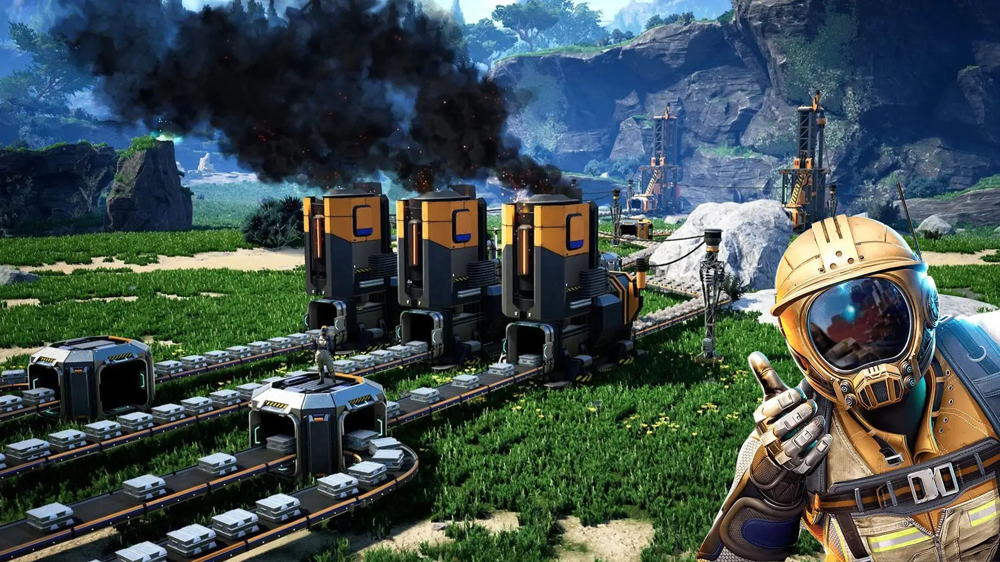

# Factory

For all the questions in this part, you will have to write your code in the `src/robots.py` file.


## Problem

You crashed on a planet. Your objective is to gather some resources to repair your spaceship.

You can find 4 types of resources in the planet: _iron_, _copper_, _silicon_ and _uranium_.
To gather these resources, you can produce some _robots_ in the `Factory` that you installed on the
planet.
Each _robot_ can gather one type of resource:

- an _iron robot_ can gather _iron_
- a _copper robot_ can gather _copper_
- a _silicon robot_ can gather _silicon_
- a _uranium robot_ can gather _uranium_

Each _robot_ can gather $1$ resource per time unit. You can produce as many _robots_ as you want.


Your objective is to gather $6$ units of _uranium_. You need to find the minimum time needed to gather these resources.


---
> You can go to
> - [Part 1: _Analyzing Mario Kart 8 World Records_](mario_kart_wr.md)
> - the [main page](README.md)
---




## Your class factory

A `Factory` is a class that represents the state of your factory. A `Factory` can produce _robots_ by using _resources_. 
The cost of each _robot_ is defined by a _blueprint_ that represents the number of _resources_ needed to produce each _robot_. 

To create a `Factory`, you need to provide
- a _blueprint_ that represents the cost of each _robot_ to produce it
- the list of the _robots_ you have in your factory
- the initial number of each _resources_ you have

### 1. The constructor

:pencil: Complete the class `Factory` by adding a constructor that takes the following arguments:
- `blueprint` (`Dict[str, List[int]]`): it represents the cost of each _robot_ to produce it.
- `robots` (`List[int]`): it represents the number of each _robot_ type you have in your _factory_.
- `resources` (`List[int]`): it represents the number of each _resource_ you have in your _factory_.
- `step` (`int`): it represents the time spent to reach this state (will be used after). It should be optional and default to `0`.

This constructor must set the `blueprint`, `robots`, `resources` and `step` attributes.

> :warning: **Warning**
>
> In the constructor, the `robots` and `resources` lists provided as argument must be **copied** to avoid any side effects.

```python
blueprint1 = {
    'ironRobot': [2, 0, 0, 0],
    'copperRobot': [4, 0, 0, 0],
    'siliconRobot': [2, 2, 0, 0],
    'uraniumRobot': [3, 2, 2, 0]
}
```

In this example, you can produce 4 types of _robots_: `ironRobot`, `copperRobot`, `siliconRobot` and `uraniumRobot`. And the resources needed to produce an `ironRobot` are 2 _iron_, 0 _copper_, 0 _Silicon_ and 0 _Uranium_.

Once you defined the rules to produce the _robots_, you need to provide the number of _robots_ and _resources_ you have in your _factory_.

```python
robots = [1, 0, 0, 0]
resources = [0, 0, 0, 0]

my_factory = Factory(blueprint1, robots, resources)
```

In this example, you have 1 _iron robot_ and no other _robots_ and no _resources_.

### 2. Check if you can produce a robot

:pencil: Create a method `can_build_robot` that takes a `robot` as a `str` and returns `True` if you can produce this `robot` and `False` otherwise.

This method, depending on the `robot` name must read the `blueprint` and check if you have enough resources to produce this `robot`.

### 3. Produce a robot

:pencil: Create a method `produce_robot` that takes a `robot` as a `str` and returns a new `Factory` object that represents the state of the factory after producing this `robot`.

This method must check if you can produce the `robot` and if you can, it must return a new `Factory` object with the updated number of `robots` and `resources`.
The new `Factory` object must have the `step` attribute incremented by 1 (as it takes 1 time unit to produce a `Robot`).

If you cannot produce the `robot`, the method must return `None`.

### 4. Gather resources

A possible _move_, that takes 1 time unit, is to gather resources.

:pencil: Create a method `gather_resources` that doesn't take any argument (except `self`) and returns a new `Factory` object that represents the state of the factory after gathering the resources.

Each _robot_ gathers 1 resource per time unit. So, if you have 3 `ironRobot`, you can gather 3 _iron_ resources in 1 time unit, so the new `Factory` object must have the updated number of `resources` and the `step` attribute incremented by 1.

## 5. Finding the minimum time to gather the needed resources

Now, you need to find the minimum time needed to gather the resources to reach a _goal_.

For that, we will see the problem as a graph. The nodes are all the possible factory states, i.e.
_robots_ and _resources_ combinations.

An edge between two states means that there is a way to go from the first factory to the second, e.g.
by producing a robot or gathering resources.

The graph of factory states is then infinite because we assume we can produce as much resources as
we want.

You first need to find all the possible _moves_ you can do from your `Factory` state.
A _move_ is the action of producing a _robot_ **or** gathering _resources_. But you cannot have a _move_
that produces a _robot_ and gathers a resource at the same time. It's either one or the other.

:pencil: Create the function `get_neighbors` that takes as argument a `state` of type `Factory` and returns a list of tuple `(state, cost)`: `List[Tuple[Factory, float]]`. Each tuple contains a `Factory` object that is the result of a possible _move_ from the initial `state` with the cost of this _move_, that is the time needed to do this _move_ (1 time unit to produce a _robot_ and 1 time unit to gather a resource).

> :bulb: **Note**
>
> it is possible that the list of neighbors only contains a single neighbors, i.e. resource gathering,
> if no resources are currently available to produce a robot.


For example, if you have the following `Factory` object:

```python
blueprint = {
    'ironRobot': [2, 0, 0, 0],
    'copperRobot': [4, 0, 0, 0],
    'siliconRobot': [2, 2, 0, 0],
    'uraniumRobot': [3, 2, 2, 0]
}
robots = [2, 0, 0, 0]
resources = [3, 3, 3, 0]
my_factory = Factory(blueprint, robots, resources, 15) # 15 minutes spent

neighbors = get_neighbors(my_factory)
```

In this case, `neighbors` will be:
```python
[
    (Factory(blueprint, [3, 0, 0, 0], [1, 3, 3, 0], 16), 1),  # create an iron robot
    (Factory(blueprint, [2, 0, 1, 0], [1, 1, 3, 0], 16), 1),  # create a copper robot
    (Factory(blueprint, [2, 0, 0, 1], [0, 1, 1, 0], 16), 1),  # create a uranium robot
    (Factory(blueprint, [2, 0, 0, 0], [5, 3, 3, 0], 16), 1),  # gather resources
]
```

## Solving the problem

Now, you will use some algorithms to find a path from the _initial_ state to the _goal_ state inside an _infinite graph_ where the nodes are the `Factory` objects and the edges are the _moves_.

To do that, you first need to compare two `Factory` objects.

### 6. Comparing the factories

To compare two factories, you need to implement the `__eq__` method in the `Factory` class. This method must return `True` if the two factories are equal and `False` otherwise.

> :warning: **Warning**
>
> 2 `Factory` are equal if they have the same number of _uranium_ resources. If a `Factory` has less _uranium_ resources than the other, it is considered less than the other.

:pencil: Complete the `__eq__` method in the `Factory` class.

:pencil: Do the same for the `__lt__` method. This method must return `True` if the amount of _uranium_ resources in the first factory is less than the amount of _uranium_ resources in the second factory and `False` otherwise.

### 7. Turning on the factory

Now, try to find the minimum time needed to gather the resources to reach the `goal`. The `goal` is the state where you have 3 _uranium_ resources.

You can use the helper functions `dijkstra` and `a_star` to find this minimum time. Those functions are already written in `src/path_finding.py`.

:pencil: Create a `Factory` object with the following parameters:

```python
blueprint = {
    'ironRobot': [2, 0, 0, 0],
    'copperRobot': [4, 0, 0, 0],
    'siliconRobot': [2, 2, 0, 0],
    'uraniumRobot': [3, 2, 2, 0]
}
robots = [1, 0, 0, 0]
resources = [0, 0, 0, 0]
```

:pencil: Define the `goal` state where you have 6 _uranium_ resources, and create the final `Factory` object you want to reach.

```python
goal = [0, 0, 0, 6]
```

:pencil: Use the `dijkstra` function to get the optimal path to reach the `goal` state.
This function will return a `path` that is a list of `Factory` objects that represent the path from the initial state to the `goal` state.
Print the path and the time needed to reach the `goal` state.

You must ensure that running `python src/robots.py` will show your answer, without any extra text,
i.e. something like
```
solution found with Dijkstra in 123.45ms
```

### Optimizing the search with A*

The `dijkstra` function is not the most efficient way to find the minimum time needed to reach the `goal` state. You can use the `a_star` function to optimize the search.

#### 8. The heuristic

To do that, you first need to define your heuristic, as `a_star` needs a heuristic function to work.

Of course, you cannot estimate a euclidean distance between two `Factory` objects. But you can estimate the distance in terms of the number of _uranium_ resources you need to reach the `goal` state.

> :warning: **Warning**
>
> Don't forget that a _distance_, _euclidean_ or not, must be a **positive** number !

:pencil: Create a heuristic function `heuristic` that takes as arguments a `state` and a `goal` of type `Factory` and returns a `float` that represents the estimated distance between the `state` and the `goal` state.

#### 9. Using A*

:pencil: Now, use the `a_star` function and check if you get the same result as with the `dijkstra` function. Instead of printing the path for A*, which should be the same, you can _assert_ they are equal, e.g. the following should not give any errors:
```python
dijkstra_path = ...
a_star_path = ...
assert dijkstra_path == a_star_path
```

:pencil: Measure the time needed to find the path with the `dijkstra` and `a_star` functions, and print both times.

You must ensure that running `python src/robots.py` will show your answer, without any extra text,
i.e. something like
```
solution found with Dijkstra in 123.45ms
solution found with A* in 54.321ms
```

### 10. Plot your simulation

:pencil: Create a plot that shows the number of each _resources_ and the number of `robots` in the `Factory` objects in the path found with the `dijkstra` or `a_star` function.

You must ensure the following:
- running `python src/robots.py` shows the figure
- everything is on the same figure
- there is a legend
- there should be a grid for better readability
- the data is clear and easy to read, e.g. no weird limit values on the axis, no
  need to zoom in, ...
- the colors for a _robot_ and a _resource_ of the same type should be the same, and the `linestyle` for a
  _resource_ should be dashed.
    - `iron` resources and robots should be red
    - `copper` resources and robots should be orange
    - `silicon` resources and robots should be blue
    - `uranium` resources and robots should be green

```python
import matplotlib.pyplot as plt

plt.plot(iron_robot_vals, label='iron', color='red') # plot the number of robots of a given type
plt.plot(iron_resources_vals, label='iron', color='red', linestyle='dashed') # plot the number of resources of a given type

# same with the other resources

plt.grid() # Add a grid
plt.legend() # Add a legend
plt.show() # Show the plot
```

---
> This part is now over, you can go to
> - [Part 1: _Analyzing Mario Kart 8 World Records_](mario_kart_wr.md)
> - the [main page](README.md) to zip everything and submit your work
